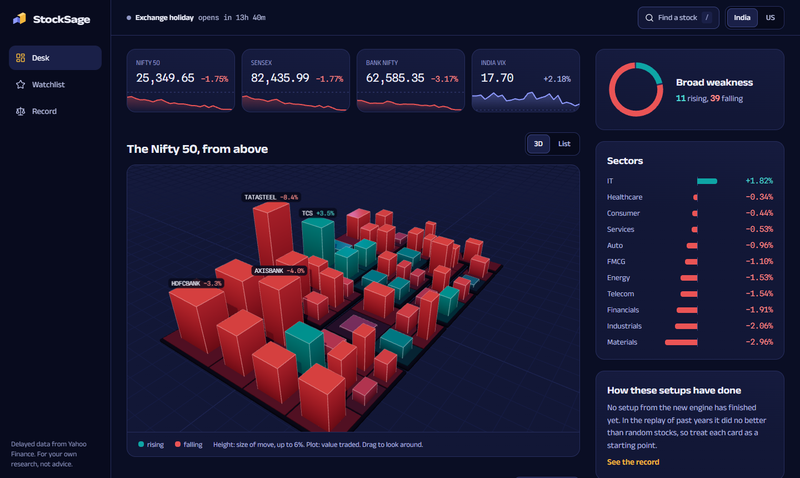
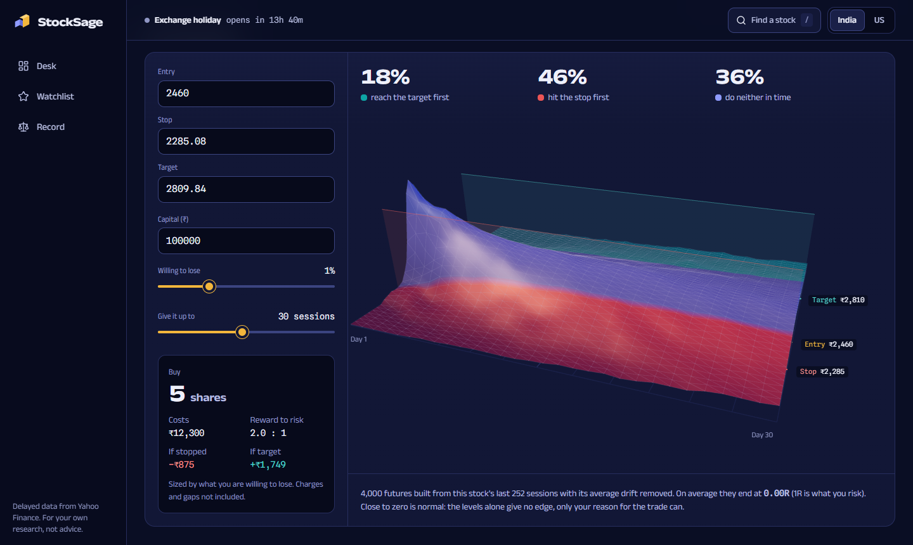

# StockSage

A research and trade-planning desk for Indian equities (with a US view) that shows the evidence on both sides of every idea and **grades itself against random stocks**.



## What it does

- **The market in 3D.** The Nifty 50 as a city you can turn around: plot size is value traded, height is the size of the move, colour is direction. There is a flat list for keyboards and older devices.
- **Setups with both sides.** Each card shows what speaks for the idea and what speaks against it, with stop, entry, target and the live price on one rail. There is no "confidence" score.
- **Trade planner.** Sizes the position from what you are willing to lose, then simulates 4,000 futures from the stock's own behaviour and draws them as terrain.
- **A record that is hard to fool.** Every setup is followed on real prices to its stop, target or time limit, and compared with random stocks bought at the same moment under the same rule.
- **AI research notes.** Argues for and against using only the data on the page. Any statement with a number that is not in that data is removed, and the note says so.
- **Works when the market is closed.** After the close it scans finished bars, and setups wait for the next open.



## Does the engine work?

Not better than chance, and the app says so. Replayed over the Nifty 50 from December 2022 to November 2026, seeing only the past at each step:

| | Trades | Engine | Random stocks, same day, same rule | Difference (95% range) |
|---|---|---|---|---|
| India | 1,507 | +0.14R | +0.17R | −0.02R (−0.08 to +0.03) |
| US | 962 | +0.17R | +0.21R | −0.04R (−0.14 to +0.06) |

R is profit divided by the amount risked. Before costs. Reproduce it with `python -m backend.replay india us`. The current engine is a baseline to beat, not a source of tips.

## Run it

Needs Python 3.11+ and Node 22+.

```bash
python -m venv .venv
.venv\Scripts\activate            # Windows; on Mac/Linux: source .venv/bin/activate
pip install -r backend/requirements.txt
copy .env.example .env            # optional: add GROQ_API_KEY for AI notes
python run.py                     # API on :8000

cd frontend
npm install
npm run dev                       # UI on http://localhost:5173
```

The first start takes a couple of minutes to scan and to grade the imported history. Or `docker build -t stocksage . && docker run -p 8080:80 -v stocksage:/data stocksage`.

## How it fits together

```
backend/
  market_hours.py      sessions, holidays and half days from real exchange calendars
  universe.py          Nifty 50 from NSE's own file, refreshed weekly
  providers/yahoo.py   the only module that talks to a price source
  engine/              pure functions: indicators, signals, outcome, odds
  services/            scan, track (grading), notes (AI)
  replay.py            the engine over history, against a random control
  main.py, schemas.py  API and its contract
frontend/
  openapi.json         generated from the backend; src/api/schema.d.ts is generated from it
  src/three/           the 3D scenes
  src/pages/           Landing, Desk, Stock, Record, Watchlist
tests/                 run with pytest
```

Data flows one way: provider, engine, database, API, UI. The frontend's types are generated from the backend, and CI fails if they drift apart.

## Rules the code enforces

- A reason listed for a signal always points the same way as the signal, and a tie is not a signal.
- A stop hit counts as a stop, even if the price recovers later. A bar that touches both levels counts as a stop.
- Setups made while the market is shut fill at the next open, and are void if that open is already past a level.
- A price is only called "today" if it is from today.
- If the AI fails, the page says it failed.

## Checks

```bash
pip install -r backend/requirements-dev.txt
ruff check backend tests scripts && pytest -q
cd frontend && npm test && npm run build
```

After changing the API: `python scripts/export_openapi.py && cd frontend && npm run gen:api`.

## Deploying

Backend on any Python host with `DATABASE_URL` set to Postgres (a free Neon database is enough); without it, history is lost on restart. Run one worker, because the scan loop lives in it. Frontend on Vercel with `VITE_WS_URL` pointing at the backend.

## Limits

Prices come from Yahoo Finance: unofficial, delayed, and for personal use. Exchange data may not be shown publicly without a licence. This is a personal research tool, not investment advice.

MIT licence.
